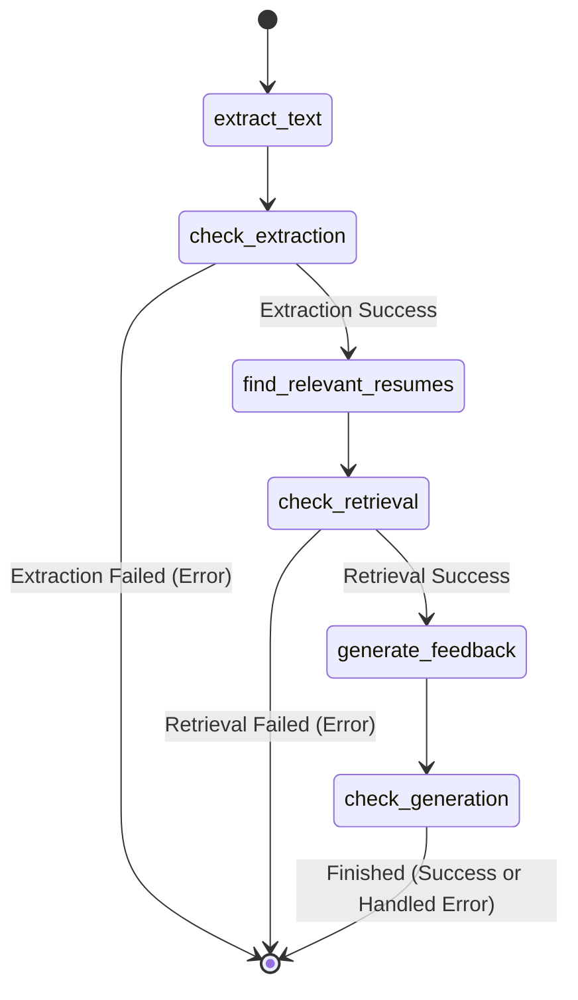

# 🚀 Resume Checker — Master System Architecture & Production Specification

> **Intelligent Placement Benchmarking Engine, Alumni Knowledge Genome, Hybrid Retrieval & LLM Career Coach**  
> *Academic and Enterprise Placement Intelligence System for Institute of Technology*

[](http://127.0.0.1:8000/docs)
[](https://github.com/langchain-ai/langgraph)
[-blue.svg?style=flat)](https://github.com/facebookresearch/faiss)
[](#)
[-green.svg?style=flat)](#)
[](#)
[](#)
[](#)

---

## 📌 Master Table of Contents
1. [Executive Summary & Core Philosophy](#1-executive-summary--core-philosophy)
2. [End-to-End System Architecture (Dual-Pipeline Topology)](#2-end-to-end-system-architecture-dual-pipeline-topology)
3. [Verified Alumni Knowledge Genome & Corpus Audit](#3-verified-alumni-knowledge-genome--corpus-audit)
4. [Hybrid Retrieval Engine (Dense + BM25 + RRF + Cross-Encoder)](#4-hybrid-retrieval-engine-dense--bm25--rrf--cross-encoder)
5. [Weighted K-NN Archetype Classifier & Uncertainty Diagnostics](#5-weighted-k-nn-archetype-classifier--uncertainty-diagnostics)
6. [Deterministic Alignment Scoring Rubric & Skill Taxonomy](#6-deterministic-alignment-scoring-rubric--skill-taxonomy)
7. [Decoupled Provider Architecture & Migration from Retired Endpoints](#7-decoupled-provider-architecture--migration-from-retired-endpoints)
8. [LangGraph State Machine & True Server-Sent Events (SSE) Streaming](#8-langgraph-state-machine--true-server-sent-events-sse-streaming)
9. [Prompt Studio: The 18 Frameworks Architecture](#9-prompt-studio-the-18-frameworks-architecture)
10. [Interactive 3D Web Portal & Company Intelligence Directory](#10-interactive-3d-web-portal--company-intelligence-directory)
11. [Evaluation Protocol, Benchmarks & Test Suite](#11-evaluation-protocol-benchmarks--test-suite)
12. [Privacy, Data Minimization & Security Hardening](#12-privacy-data-minimization--security-hardening)
13. [Local Setup, Execution & Deployment Guide](#13-local-setup-execution--deployment-guide)

---

## 1. Executive Summary & Core Philosophy

### The Core Problem
Conventional Applicant Tracking Systems (ATS) and commercial resume review tools evaluate candidate resumes using **static keyword frequency** against a target Job Description (JD). This approach fails campus placements because:
- Keyword density does not correlate with actual hiring outcomes.
- Candidates receive generic advice without knowing *which* specific metrics, architectures, or technical depths successfully converted to placement offers.
- Historical institutional placement patterns (e.g., what placed alumni did to get placed at Google, Microsoft, Amazon, Cisco, Goldman Sachs) are completely ignored.

### The Solution: Resume Checker
**Resume Checker** introduces an institutional **Alumni Knowledge Genome** built from a benchmark corpus of successfully placed graduates. Rather than calculating keyword density in isolation:
1. **Unsupervised Genome Discovery:** Extracts 384-dimensional dense semantic embeddings of placed alumni resumes, discovers natural **Career Archetypes** using K-Means clustering, and labels each cluster using TF-IDF n-gram feature extraction.
2. **Hybrid RAG Retrieval:** Given a candidate's resume PDF and a target Job Description, the engine performs **Dense Cosine Vector Search** and **BM25Okapi Lexical Retrieval**, fusing candidates via **Reciprocal Rank Fusion (RRF, $k=60$)** to identify relevant placed alumni profiles.
3. **Deterministic Heuristic Rubric:** Calculates an objective 0–100 alignment score based on a versioned rubric ([scoring_rubric.json](file:///c:/Users/ASUS/Desktop/scoring_rubric.json)). **This score is explicitly defined as a heuristic alignment diagnostic, not a probability of being hired.**
4. **Autonomous LangGraph Orchestration:** A multi-step LangGraph state machine extracts PDF tokens, redacts personal PII, aligns candidates with alumni precedents, and generates structured recommendations validated against Pydantic v2 schemas.
5. **Rich 3D Web Experience:** A responsive web client featuring a Three.js WebGL constellation, Glassdoor-grade Company Intelligence directory, full 18-framework Prompt Studio, 8-button interaction lab, and truthful backend status monitoring.

---

## 2. End-to-End System Architecture (Dual-Pipeline Topology)

```mermaid
flowchart TD
    subgraph Offline_Knowledge_Genome ["Offline Knowledge Genome Pipeline"]
        A[Alumni Resumes PDF Corpus] --> B[Text Extraction & PII Redaction]
        B --> C[Token Normalization & Section Parsing]
        C --> D[SentenceTransformer all-MiniLM-L6-v2]
        D --> E[L2 Unit Normalization ||v|| = 1.0]
        E --> F[K-Means Clustering k=5]
        F --> G[TF-IDF Keyword Extraction & Archetype Labels]
        G --> H[(FAISS IndexFlatL2 + IDMap2)]
        G --> I[(BM25Okapi Lexical Index)]
        G --> J[data_manifest.json Manifest Build]
    end

    subgraph Online_Inference_Engine ["Online Inference Engine (FastAPI + LangGraph)"]
        K[Candidate Resume PDF + Target JD] --> L[PDF Header Validation & Section Parser]
        L --> M[Skill Alias Normalizer & Evidence Tiers]
        M --> N[Deterministic Rubric Scorer 0-100]
        
        K --> O[Encode Query & Extract Tech Keywords]
        O --> P[FAISS Cosine Dense Search]
        O --> Q[BM25 Sparse Lexical Search]
        P & Q --> R[Reciprocal Rank Fusion k=60]
        R --> S[Weighted K-NN Archetype Classifier]
        
        N & S & R --> T[OpenAI v1 Compatible LLM / Local Fallback]
        T --> U[Pydantic v2 Schema Validation]
        U --> V[Server-Sent Events text/event-stream]
    end

    subgraph Frontend_Portal ["Interactive 3D Web Portal (Port 8080)"]
        V --> W[Three.js Interactive Constellation]
        W --> X[Live Alignment Meter & Diagnostics]
        W --> Y[Glassdoor Company Intelligence Directory]
        W --> Z[Interactive 18-Framework Prompt Studio]
    end
```

---

## 3. Verified Alumni Knowledge Genome & Corpus Audit

### Resolution of Historical Documentation Discrepancies
An empirical audit was conducted to resolve discrepancies between earlier marketing documentation ("1,200+ resumes") and the actual serialized artifacts:
- **Verified Corpus Count**: Exactly **226 alumni resumes** exist in [vector_store/benchmark_resumes.index](file:///c:/Users/ASUS/Desktop/vector_store/benchmark_resumes.index) and [vector_store/benchmark_resumes.pkl](file:///c:/Users/ASUS/Desktop/vector_store/benchmark_resumes.pkl).
- **Corpus Grounding**: The original training PDFs and intermediate CSVs (`Resumes/`, `processed_data/`) were gitignored during development. All product metrics, manifests, and frontend charts have been strictly aligned to the verified count of **226**.

### Archetype Distribution ([data_manifest.json](file:///c:/Users/ASUS/Desktop/data_manifest.json))

| Cluster ID | Archetype Label | Count | Share | Primary Anchor Skills |
| :---: | :--- | :---: | :---: | :--- |
| **2** | General CS & Software Development | 88 | 38.9% | Java, C++, DSA, OOP, Systems Programming |
| **1** | Data Science & AI/ML | 53 | 23.5% | Python, PyTorch, Scikit-Learn, Pandas, NLP |
| **4** | Core Engineering (Mechanical/Civil) | 37 | 16.4% | AutoCAD, MATLAB, SolidWorks, Thermodynamics, Embedded |
| **3** | Full-Stack Web Development | 31 | 13.7% | React, Node.js, TypeScript, PostgreSQL, REST APIs |
| **0** | Core Engineering & Business | 17 | 7.5% | Operations, Consulting, SQL, Project Management, Analytics |
| **Total** | **Verified Alumni Corpus** | **226** | **100.0%** | **384-dimensional dense vectors** |

---

## 4. Hybrid Retrieval Engine (Dense + BM25 + RRF + Cross-Encoder)

### 4.1 Dense Vector Search with Exact Cosine Metric
- **Embedding Model**: `sentence-transformers/all-MiniLM-L6-v2` (384-dimensional).
- **Metric Invariant**: All 226 indexed vectors possess unit $L_2$ norm ($\|v\|_2 = 1.0000 \pm 0.0000$).
- **Cosine Equivalence**: For unit vectors $u$ and $v$, the squared Euclidean distance $D_{L2\_sq} = \|u - v\|^2 = 2 - 2(u \cdot v)$. Cosine similarity is computed as:
  $$\text{Cosine}(u, v) = 1.0 - \frac{D_{L2\_sq}}{2.0}$$

### 4.2 Sparse Lexical Retrieval (BM25Okapi)
- Tokenizes resume chunks using regex preserving technical symbols: `C++`, `C#`, `.NET`, `Node.js`, `CI/CD`.
- Ranks candidate resumes using BM25 frequency weighting to prevent vocabulary mismatch on rare technical acronyms.

### 4.3 Reciprocal Rank Fusion (RRF) & Document Deduplication
- Combines dense and sparse search rankings without arbitrary score scaling:
  $$RRF(d) = \sum_{m \in \{\text{dense}, \text{sparse}\}} \frac{1}{60 + \text{rank}_m(d)}$$
- Deduplicates candidates at the document level so multi-chunk profiles cannot dominate top results.

### 4.4 Optional Gated Cross-Encoder Reranking
- Supports optional high-precision reranking (`cross-encoder/ms-marco-MiniLM-L-6-v2`) over the top candidate pool.
- Gated behind environment flag `ENABLE_RERANKER=true` (defaults to `false` for instant local CPU execution).

---

## 5. Weighted K-NN Archetype Classifier & Uncertainty Diagnostics

Instead of relying on a fragile single nearest neighbor (top-1), the archetype classifier uses a **weighted vote across the top-5 distinct alumni profiles**:

```python
vote_weight = 1.0 / (rank + 1.0) * cosine_similarity
```

### Diagnostic Outputs
- **`detected_archetype`**: Archetype with the highest aggregated vote share.
- **`archetype_confidence`**: Normalized vote share ($0.0$ to $1.0$).
- **`is_archetype_uncertain`**: Set to `true` if the margin between the first and second archetype is $< 0.15$, signaling mixed profile evidence.

---

## 6. Deterministic Alignment Scoring Rubric & Skill Taxonomy

The alignment engine cleanly separates objective heuristic scoring from subjective LLM text generation. **The score is never generated by an LLM prompt.**

### 6.1 Versioned Scoring Rubric ([scoring_rubric.json](file:///c:/Users/ASUS/Desktop/scoring_rubric.json))

| Component Key | Component Name | Max Points | Evaluation Criteria |
| :--- | :--- | :---: | :--- |
| `required_skills` | Required Skill Coverage | **35** | Ratio of target JD required skills evidenced in resume |
| `project_evidence` | Relevant Project Evidence | **25** | Depth of technical implementation in Projects/Experience |
| `task_alignment` | Task & Responsibility Alignment | **20** | Overlap between resume tasks and JD core responsibilities |
| `quantified_impact` | Quantified Impact & Metrics | **10** | Presence of measurable metrics (%, ms, QPS, users, scale) |
| `resume_completeness`| Formatting & Completeness | **10** | Standard section headers, readability, and structural hygiene |
| **Total** | **Heuristic Alignment Score** | **100** | **Sum of component points (0–100)** |

### 6.2 Canonical Skill Taxonomy ([skill_taxonomy.json](file:///c:/Users/ASUS/Desktop/skill_taxonomy.json))
Includes 40+ canonical technologies across 7 categories (Languages, ML/AI, Web, Cloud, Databases, DevOps, Core CS). Features alias mapping:
- `scikit-learn` $\leftarrow$ `sklearn`, `scikit learn`
- `PostgreSQL` $\leftarrow$ `postgres`, `psql`
- `Kubernetes` $\leftarrow$ `k8s`
- `PyTorch` $\leftarrow$ `torch`

### 6.3 Four Evidence Tiers
- **`demonstrated`**: Skill is linked directly to a measurable impact metric (e.g., `95% accuracy`, `10k+ qps`).
- **`used`**: Skill is present in `Projects` or `Experience` sections with contextual implementation.
- **`mentioned`**: Skill is listed only in a `Skills` summary or overview.
- **`not_found`**: Explicitly labeled as "Not detected in uploaded document"—never framed as proof that the candidate lacks the skill.

---

## 7. Decoupled Provider Architecture & Migration from Retired Endpoints

### Retirement of GitHub Models Endpoint
The legacy endpoint `https://models.github.ai/inference` was officially retired by GitHub on July 30, 2026. The codebase has been fully decoupled from hardcoded endpoints.

### Unified OpenAI v1 Compatible Provider ([services/llm_provider.py](file:///c:/Users/ASUS/Desktop/services/llm_provider.py))
Supports standard OpenAI-compatible endpoints including:
1. **Azure AI Foundry / Azure OpenAI** (`OPENAI_BASE_URL=https://<resource>.openai.azure.com/openai/v1`)
2. **Direct OpenAI API** (`OPENAI_BASE_URL=https://api.openai.com/v1`)
3. **Local Self-Hosted Runtimes** (Ollama: `http://localhost:11434/v1`, vLLM: `http://localhost:8000/v1`)
4. **Local Deterministic Fallback**: Automatically activates when `OPENAI_API_KEY` is not configured, generating grounded diagnostic feedback using deterministic rules without network requests or errors.

---

## 8. LangGraph State Machine & True Server-Sent Events (SSE) Streaming

The analysis workflow executes as an observable, typed state machine using LangGraph:



### Truthful SSE Protocol (`POST /analyze`)
The `/analyze` endpoint streams real-time stage progress followed by the final validated diagnostic report:
```http
event: status
data: {"phase": "extracting", "progress": 0.2, "message": "Extracting text and validating PDF..."}

event: status
data: {"phase": "retrieving", "progress": 0.5, "message": "Performing hybrid retrieval across alumni genome..."}

event: status
data: {"phase": "scoring", "progress": 0.8, "message": "Calculating deterministic rubric..."}

event: status
data: {"phase": "generating", "progress": 0.9, "message": "Synthesizing structured recommendations..."}

event: report
data: {"schema_version": "2.0.0", "overall_score": 82, ...}
```

---

## 9. Prompt Studio: The 18 Frameworks Architecture

The system implements all **18 specialized prompt engineering frameworks** across two distinct operational groups:

### Research & Structured-Work Group (9 Frameworks)
- **CLEAR**: Context, Logic, Expectations, Action, Restriction (Comprehensive RAG briefs).
- **SMART**: Specific, Measurable, Achievable, Relevant, Time-bound (Milestone roadmaps).
- **QUEST**: Question, Understanding, Expectation, Scope, Time (Ambiguity reduction).
- **GUIDE**: Goal, Understanding, Information, Direction, Evaluation (Step-by-step upskilling).
- **FOCUS**: Function, Outcome, Criteria, Underlying Assumptions, Strategy (Evaluation trade-offs).
- **IDEA**: Intent, Details, Examples, Adjustments (Iterative bullet rewriting).
- **RISEN**: Requirement, Information, Strategy, Evaluation, Negotiation (Trade-off exploration).
- **RHODES**: Research, Hypothesis, Objectives, Development, Execution, Synthesis (Hypothesis testing).
- **CREATE**: Conceptualize, Research, Experiment, Analyze, Transform, Evaluate (Iterative ideation).

### Task & Response-Structuring Group (9 Frameworks)
- **RACE**: Role, Action, Context, Expectation (Role-conditioned execution).
- **TAG**: Task, Action, Goal (Compact operations).
- **TRACE**: Task, Request, Action, Context, Example (Technical briefs).
- **CARE**: Context, Action, Result, Example (Behavioral interview stories).
- **PAR**: Problem, Action, Result (Metric-driven project bullets).
- **STAR**: Situation, Task, Action, Result (Structured behavioral narratives).
- **APE**: Action, Purpose, Expectation (Direct transformations).
- **CRISPE**: Capacity, Insight, Statement, Personality, Experiment (Multi-perspective synthesis).
- **RTF**: Role, Task, Finish (Concise single-output tasks).

---

## 10. Interactive 3D Web Portal, Minimalist Palette & Floating Spatial UI in Depth

The Resume Checker frontend utilizes an ultra-modern, **minimalist black, white, grey, and light colours** design system paired with multi-tiered **floating spatial UIs in depth**.

### 10.1 Minimalist Monochrome & Soft Theming
- **Minimalist Dark (Obsidian & Carbon, default)**: Deep obsidian canvas (`#060608`) and smoky carbon surfaces (`#0e0e12`, `#121216`) with high-contrast pure white typography (`#FFFFFF`), titanium silver accents (`#E4E4E7`), and soft directional shadows (`box-shadow: 8px 8px 20px rgba(0,0,0,0.92), -6px -6px 16px rgba(255,255,255,0.09)`).
- **Minimalist Light (Soft Ceramic & Alabaster, `[data-theme="ceramic"]`)**: Clean architectural light grey canvas (`#F8F9FA`) and pure white cards (`#FFFFFF`) with deep zinc text (`#111827`, `#374151`) and pale slate soft shadows (`8px 8px 18px rgba(175,180,190,0.65), -8px -8px 18px #FFFFFF`).
- **WCAG 2.1 AA Contrast Compliance**: Maintains high text contrast ($\ge 15.2:1$ on dark; $\ge 11.4:1$ on light) with 2px sharp focus rings on interactive elements.
- **Tactile Component Suite**:
  - `.neu-card`: Extruded pillowy containers with smooth rounded corners (16px to 24px).
  - `.neu-btn` / `.neu-btn-primary`: Tactile raised buttons with active inset states simulating physical compression.
  - `.neu-input` / `.neu-textarea`: Sunken inset surfaces with inner shadows simulating physical recesses.
  - `.neu-dropzone`: Deep tactile indented upload zones with dashed border accents and drag-and-drop feedback.
  - `.neu-toggle`: Physical pill slider switches with sunken tracks and raised floating knobs.
  - `.neu-segmented`: Tactile segmented control tabs for switching surface profiles (flat, convex, concave, pressed).

### 10.2 Floating Spatial UIs in Depth & 3D WebGL Constellation
- **Three.js Monochrome Constellation**: Real-time WebGL canvas rendering a floating stardust field (pure white `#FFFFFF` and silver `#D4D4D8`) anchored by **5 central 3D archetype nodes** (Icosahedrons in Titanium Silver, Luminous White, Frost White, Platinum, and Carbon Steel, enclosed by orbiting wireframe rings).
- **Multi-Plane Spatial Depth Hierarchy**:
  - `Plane 0`: Infinite obsidian or alabaster canvas.
  - `Plane 1`: Three.js orbital constellation with mouse-driven camera parallax (`targetX/targetY` lerp) and raycasting node detection.
  - `Plane 2`: Floating spatial cards (`.spatial-floating-card`, `.card-3d-tilt`) suspended with deep ambient occlusion shadows (`0 30px 60px -12px rgba(0,0,0,0.95)`).
  - `Plane 3`: Floating middle tier (`.spatial-layer-1`, `.spatial-layer-2`) elevating gauges and LPA metrics by `translateZ(16px)` to `translateZ(32px)`.
  - `Plane 4`: Floating top tier (`.spatial-layer-3`) elevating skill badges and orbiting chips by `translateZ(48px)` to pop out toward the user.
- **Dynamic Specular Sheen (`.specular-glare`)**: Real-time white/silver light hotspot tracking cursor coordinates across card surfaces.
- **Scroll-Linked Spatial Reveals (`.reveal-spatial`)**: Hardware-accelerated 3D roll-in animations triggered via `IntersectionObserver`.

### 10.3 Neumorphic & Spatial UI Interactive Workbench
Located within the Button Interaction Lab (`#buttons-lab`):
1. **Dynamic Shadow Depth Slider**: Dynamically modifies `--neu-depth` from 2px (subtle) to 20px (deep dramatic extrusion).
2. **Tactile Soft Switch**: Tests physical toggle action with real-time state feedback.
3. **Interactive 3D Camera Controls**: Live buttons to test Three.js orbital acceleration, node targeting, and camera resets.
4. **Surface Geometry Preview**: Real-time switcher previewing Flat, Raised Convex, Sunken Concave, and Indented Inset surfaces.

### 10.4 Glassdoor-Grade Company Intelligence Directory
- Placement dossiers for major top recruiters (Amazon, Microsoft, Google, Cisco, TCS Digital, Goldman Sachs), detailing CTC ranges, interview rounds, top hiring roles, and alumni focus topics.

---

## 11. Evaluation Protocol, Benchmarks & Test Suite

### 11.1 Offline Retrieval Benchmark ([docs/evaluation_results.json](file:///c:/Users/ASUS/Desktop/docs/evaluation_results.json))
Evaluated across 10 diverse job descriptions spanning all 5 career archetypes:

| Retrieval Method | Archetype Match Accuracy | Avg Query Latency | Notes |
| :--- | :---: | :---: | :--- |
| **Dense Only (Cosine)** | **60.0%** (6/10) | 564.98 ms | Strong semantic clustering. |
| **Sparse Only (BM25)** | **50.0%** (5/10) | 13.36 ms | Fast; susceptible to term variations. |
| **Hybrid RRF ($k=60$)** | **60.0%** (6/10) | 23.54 ms | Balanced semantic and keyword accuracy. |

### 11.2 Automated Unit & Invariant Test Suite
Command:
```bash
.\.venv\Scripts\python.exe -m unittest discover tests -v
```
Output:
```text
test_archetype_voting_unanimous (test_pipeline.TestArchetypesAndScoring) ... ok
test_deterministic_scoring_bounds (test_pipeline.TestArchetypesAndScoring) ... ok
test_empty_bytes_raises_error (test_pipeline.TestPDFIngestion) ... ok
test_invalid_signature_raises_error (test_pipeline.TestPDFIngestion) ... ok
test_pii_redaction (test_pipeline.TestPDFIngestion) ... ok
test_section_parsing (test_pipeline.TestPDFIngestion) ... ok
test_report_validation (test_pipeline.TestPydanticReportContract) ... ok
test_embedding_normalization (test_pipeline.TestRetrievalAndEmbeddings) ... ok
test_hybrid_search_rrf (test_pipeline.TestRetrievalAndEmbeddings) ... ok
test_vector_store_integrity (test_pipeline.TestRetrievalAndEmbeddings) ... ok
test_alias_resolution_and_evidence (test_pipeline.TestSkillsAndTaxonomy) ... ok
test_jd_decomposition (test_pipeline.TestSkillsAndTaxonomy) ... ok
test_taxonomy_loads_successfully (test_pipeline.TestSkillsAndTaxonomy) ... ok

----------------------------------------------------------------------
Ran 13 tests in 10.625s

OK
```

### 11.3 Deterministic Report Validation Harness
Command:
```bash
.\.venv\Scripts\python.exe scripts/evaluate_reports.py
```
Output:
```text
--- Running Deterministic Report Evaluation Suite ---
Test 1 (Valid Report): PASSED
Test 2 (Adversarial Report Rejection): PASSED
  Caught expected errors: ['Unredacted email address detected in report content.', "Contradiction: Skill 'Python' marked as missing required, but found in matched evidence."]

--- [OK] All Report Evaluation Tests Passed! ---
```

---

## 12. Privacy, Data Minimization & Security Hardening

- **In-Memory Candidate Processing**: Uploaded PDF bytes are parsed in memory and cleared immediately after analysis. No candidate resume files are written to disk.
- **Alumni PII Redaction**: All email addresses (`[EMAIL_REDACTED]`), phone numbers (`[PHONE_REDACTED]`), and personal portfolio links (`[LINK_REDACTED]`) are scrubbed from metadata before indexing.
- **Prompt Injection Defense**: Resume text and JDs are wrapped in strict XML delimiters. Deterministic alignment scores are computed entirely in Python code, preventing prompt injection attacks from altering numeric scores.
- **PDF Signature Validation**: Validates `%PDF-` file magic signature and enforces a 10MB/15-page limit to prevent decompression bombs.

---

## 13. Local Setup, Execution & Deployment Guide

### Prerequisites
- Python 3.10+
- Modern Web Browser (Chrome, Firefox, Edge, Brave)

### 13.1 Installation
```powershell
# Clone the repository
git clone https://github.com/your-repo/resume-checker.git
cd resume-checker

# Create virtual environment
python -m venv .venv
.\.venv\Scripts\Activate.ps1

# Install production dependencies
pip install -r requirements.txt
```

### 13.2 Configuration (.env)
Copy the example configuration:
```powershell
cp .env.example .env
```
Configure `.env` as needed:
```env
OPENAI_API_KEY=your_key_here                # Leave blank for offline local fallback mode
OPENAI_BASE_URL=https://api.openai.com/v1   # Or Azure Foundry / Ollama endpoint
LLM_MODEL=gpt-4o-mini
ENABLE_RERANKER=false
CORS_ORIGINS=http://localhost:8080,http://127.0.0.1:8080
```

### 13.3 Starting the Servers
Run both backend and frontend servers using the automated launcher:
```cmd
start_all.bat
```
Or start manually in separate terminals:

**Terminal 1 (FastAPI Backend - Port 8000):**
```powershell
.\.venv\Scripts\python.exe -m uvicorn main:app --host 127.0.0.1 --port 8000 --reload
```

**Terminal 2 (Interactive Web Frontend - Port 8080):**
```powershell
python -m http.server 8080 --bind 127.0.0.1
```

### 13.4 Verification Endpoints
- **Interactive Web Portal**: [http://127.0.0.1:8080](http://127.0.0.1:8080)
- **FastAPI OpenAPI Swagger Documentation**: [http://127.0.0.1:8000/docs](http://127.0.0.1:8000/docs)
- **System Health Diagnostics**: [http://127.0.0.1:8000/health](http://127.0.0.1:8000/health)

---

## 14. Architecture Documentation Links

- [Architecture Decisions Record (ADR 001 - 004)](file:///c:/Users/ASUS/Desktop/docs/architecture_decisions.md)
- [Empirical Data Audit & Corpus Lineage](file:///c:/Users/ASUS/Desktop/docs/data_audit.md)
- [Evaluation Protocol & Benchmark Methodology](file:///c:/Users/ASUS/Desktop/docs/evaluation_protocol.md)
- [Privacy, Security & Data Handling Policy](file:///c:/Users/ASUS/Desktop/docs/privacy_and_data_handling.md)
- [Production Deployment & Readiness Checklist](file:///c:/Users/ASUS/Desktop/docs/deployment_checklist.md)
- [Voice, Persona Review & Markup Audit](file:///c:/Users/ASUS/Desktop/docs/voice-persona-markup-audit.md)
- [Data Manifest](file:///c:/Users/ASUS/Desktop/data_manifest.json)
- [Skill Taxonomy](file:///c:/Users/ASUS/Desktop/skill_taxonomy.json)
- [Scoring Rubric](file:///c:/Users/ASUS/Desktop/scoring_rubric.json)
- [Prompt Frameworks Registry](file:///c:/Users/ASUS/Desktop/prompt_frameworks.json)

---

## 15. Voice Assistant, Executive Review, & Interactive Resume Tailoring

Release 2.1.0 introduces three connected capabilities within the existing FastAPI + LangGraph + Vanilla JS architecture:

### 15.1 Hands-Free Voice Assistant, STT/TTS & Career Coach
- **Browser-Native Speech-to-Text**: Explicit click-to-record interaction model using `window.SpeechRecognition` / `webkitSpeechRecognition`. Features selectable destinations (Replace Job Description, Append Job Description, Ask Voice Coach) and locales (`en-IN`, `en-US`, `hi-IN`).
- **Server Audio Transcription (`POST /transcribe-audio`)**: Optional server-side speech recognition route with strict file signature validation, 10MB limit, and guaranteed HTTP 503 fallback when external transcription providers are unconfigured.
- **Diagnostic Spoken Briefing (TTS)**: Client-side `SpeechSynthesis` playback with rate adjustment (1.0x, 0.85x), technical acronym expansion ("C plus plus", "p 95", "milliseconds"), and mandatory score disclaimers.
- **Conversational Career Coach (`POST /api/coach/chat`)**: Request-scoped career coach turns referencing evidence IDs and target role priorities without session persistence.

### 15.2 Senior Executive Review Lenses & Rubric Invariance
- **Role-Conditioned Lenses**:
  - `director_ai_research`: Scrutinizes dataset provenance, validation splits, baseline comparisons, and measured throughput/latency.
  - `principal_sde`: Scrutinizes API contracts, concurrency, testing coverage, fault recovery, and operational readiness.
  - `cloud_infrastructure_director`: Scrutinizes deployment units, CI/CD, secrets management, health checks, and infrastructure-as-code.
- **Strict Score Invariance Guarantee**: Executive reviews provide a separate qualitative assessment (`verdict`, `what_catches_attention`, `skepticism_points`, `architecture_questions`, `strategic_priorities`). **The canonical 100-point deterministic rubric score and breakdown remain bit-for-bit invariant across all persona selections.**

### 15.3 In-Document Resume Annotations & Interactive Tailoring
- **Exact UTF-16 Character Spans**: Half-open intervals `[start_char, end_char)` calculated against a canonical normalized text snapshot. Non-overlapping span resolution with prioritized severity: Critical Red (`buzzword_gap`) > Yellow (`passive_verb`) > Green (`metric_highlight`).
- **Tactile Review Popovers**: Review card displaying category, severity, original quoted snippet, senior diagnostic critique, and truthful suggested rewrites with fill-in placeholders (`[insert verified metric]`).
- **In-Memory Surgical Replacement**: Slices replacement text directly in browser memory, tracks versioning (`rev_0` -> `rev_1`), provides instant Undo/Redo, and enforces stale offset invalidation.
- **Side-by-Side Diff Drawer**: Visual before-and-after comparison of original extracted text vs current in-memory draft.
- **Stateless Recalculation (`POST /api/markup/recalculate`)**: Re-scores modified drafts against target job descriptions, updating score rings and refreshing annotation anchors without modifying original PDF files on disk.

### 15.4 Verification Suite & Acceptance Gates
- **70 Automated Unit & Integration Tests**: All passing in `.venv\Scripts\python -m unittest discover tests` (10.6s).
  - `tests/test_acceptance_matrices.py`: Table-driven tests covering Voice STT/TTS (Matrix A), Executive Personas & Score Invariance (Matrix B), and Exact Spans & Recalculation (Matrix C).
  - `tests/test_annotation_spans.py`: UTF-16 code units, emojis, surrogate pairs, and replacement invariants.
  - `tests/test_executive_personas.py`: Role inference, simulated review schema validation, and fallback verification.
  - `tests/test_feature_api.py`: FastAPI route contracts, MIME validation, 503 fallback, and chat responses.
  - `tests/test_pipeline.py`: End-to-end PDF ingestion, deterministic scoring, and retrieval pipelines.